# Weather Chart Card

A maintained Home Assistant (HASS) weather card with daily/hourly temperature and precipitation charts, current conditions, compact headers and independently adjustable text/icon sizes.

Maintained by [Tomasz Kusmierz / tomtom13](https://github.com/tomtom13), based on [Marc Lamberts’ original card](https://github.com/mlamberts78/weather-chart-card). Report bugs and feature requests in [this fork’s issue tracker](https://github.com/tomtom13/weather-chart-card/issues).

[](https://hacs.xyz/docs/faq/custom_repositories/)
[](https://github.com/tomtom13/weather-chart-card/actions/workflows/validate.yml)
[](https://github.com/tomtom13/weather-chart-card/releases)

## Card views

These are genuine screenshots from an isolated HASS instance using **synthetic weather data**, not forecasts for a real location. Both examples use compact spacing, centre header attributes, larger wind numbers and hidden forecast units. The YAML recipes below reproduce those choices with your own entity.

### Daily
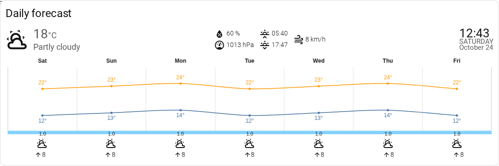

### Hourly
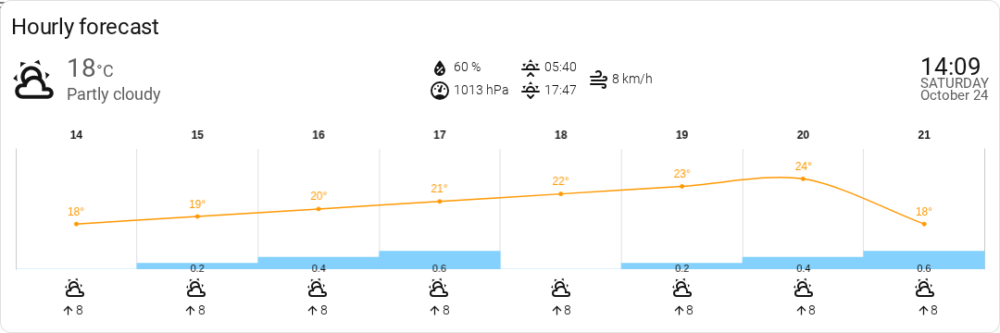

## Contents

- [Installation and updates](#installation-and-updates)
- [First card and visual configurator](#first-card-and-visual-configurator)
- [Complete configuration reference](#complete-configuration-reference)
- [Independent text, number and icon sizes](#independent-text-number-and-icon-sizes)
- [Recipes](#recipes)
- [Languages and icons](#languages-and-icons)
- [Troubleshooting](#troubleshooting)
- [Development and maintenance](#development-and-maintenance)

## Installation and updates

Supported baseline for this maintained release: **Home Assistant 2026.10.2 or newer** with HACS. The card/editor have been exercised on 2026.10.2 in Chromium; older frontends are not verified. A weather entity with daily and/or hourly forecast support is required. Solar times are optional and use `sun.sun` when available.

### Normal HACS GUI installation

This fork can be installed as a **custom repository**. A request for default-registry inclusion does not itself make a repository a HACS default.

1. Open **HACS** in HASS, then its top-right menu → **Custom repositories**.
2. Add `https://github.com/tomtom13/weather-chart-card` with category **Dashboard** (called **Lovelace/Frontend** in older HACS versions).
3. Find **Weather Chart Card**, open it and choose **Download**. Select the latest stable release for normal use.
4. Reload the browser when HACS asks. On a cached kiosk, reload that browser as well.
5. Edit a dashboard → **Add card** → **Weather Chart Card**. Select your weather entity and save the card and dashboard.

HACS normally registers the JavaScript module resource. If the card is not recognized, check **Settings → Dashboards → Resources** (advanced mode may be needed) for `/hacsfiles/weather-chart-card/weather-chart-card.js`, type **JavaScript module**. Add it there only if missing; do not add a second copy.

### Moving from another fork / original installation

All forks using `custom:weather-chart-card` register the same browser element. Do **not** load two implementations together. Back up your card YAML, remove the old Weather Chart Card installation/repository through HACS, remove only its obsolete resource entry if one remains, then install this fork through the GUI above. Existing card type/entity YAML can be retained. Finish with a full browser/kiosk reload. Do not remove unrelated dashboard cards or resources.

### Updates and rollback

Use the normal HACS **Update/Redownload** dialog and reload the frontend. No SSH, copied files, hidden scripts, or live source mounts are required. To roll back, use the same HACS dialog to select an earlier published version, then reload. Each card’s configuration is independent; updating the package does not copy one card’s settings to another.

## First card and visual configurator

Start with this minimal YAML, replacing the entity ID with one from **Developer tools → States**:

```yaml
type: custom:weather-chart-card
entity: weather.home
```

You get current conditions, available humidity/pressure/wind/solar attributes and a daily forecast chart. Omitted optional attributes are not invented. The provider determines the forecast horizon and available quantities.

In the normal dashboard card editor, the visual configurator has these pages. Changes update the preview; use **Save**, then finish dashboard editing to persist them.

| Page | Configure here | Expected outcome |
|---|---|---|
| Main | Weather entity, visibility switches, header attributes position, clock/date, icon set and absolute baseline sizes | Choose which current readings/header sections are visible. |
| Forecast | Daily/hourly, chart style, count/height, colors, animation and forecast visibility | Change the forecast presentation without changing the provider’s feed. |
| Layout | Forecast unit placement, precipitation box, tick weight/weekday names and spacing scale | Pack the card into a tighter area or stack/remove unit labels. |
| Units | Common wind unit, pressure and visibility units | Convert actual measurements consistently. Temperature follows the weather entity’s display unit. |
| Sizes | Four expandable groups of independent signed offsets | Change one text/number/icon role without scaling unrelated elements. |
| Alternate entities | Optional current-reading sensor overrides | Use your own sensor for one current attribute; forecasts still come from the weather entity. |

<details><summary>Main configurator screenshot</summary>

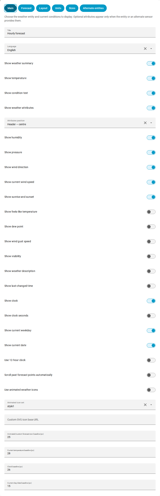
</details>
<details><summary>Forecast configurator screenshot</summary>

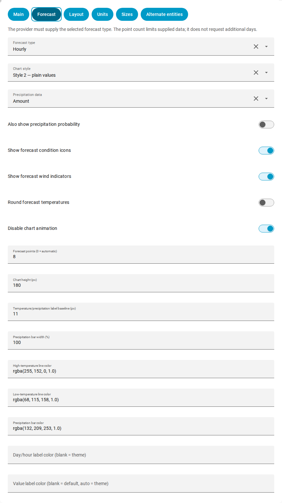
</details>

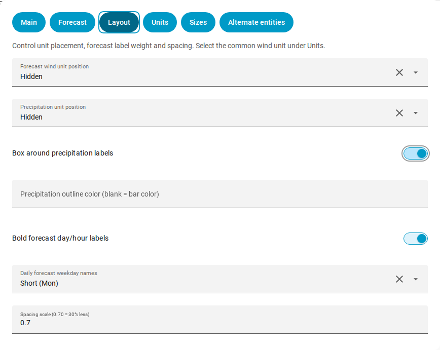

<details><summary>Units and alternate-entity configurator screenshots</summary>

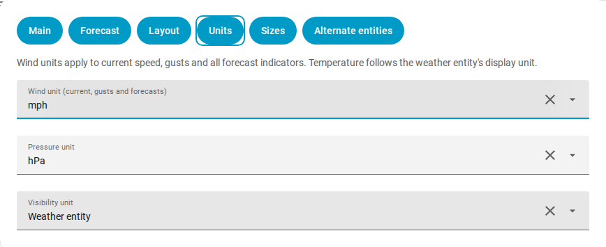
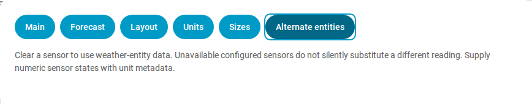
</details>

## Complete configuration reference

All YAML names below are case-sensitive. Use ordinary YAML booleans (`true`/`false`) and numeric sizes/counts. Forecast and unit keys must be nested under their mappings; `size_offsets` is a separate top-level mapping. Do not duplicate an existing `forecast:` or `units:` block when merging examples.

### Card options — Main page

The card requires top-level `type: custom:weather-chart-card`. The remaining Main-page options are:

| YAML option | Type | Default | Effect / setup |
|---|---|---|---|
| `entity` | string | `required` | Required weather entity, for example `weather.home`. Both current conditions and forecast subscriptions use it. |
| `title` | string | `none` | Optional heading above the card. Empty/omitted hides the heading. |
| `locale` | string | `HASS language` | Use a supported language code, e.g. `en`, `pl`, `nb`. Omitted follows the HASS user language. Valid regional tags such as `fr-CA` use the base-language translation where available. |
| `show_main` | boolean | `true` | Show the current icon, temperature/condition and optional clock. False hides the entire header, not the forecast. |
| `show_temperature` | boolean | `true` | Show the current temperature and its unit inside the header. |
| `show_current_condition` | boolean | `true` | Show the translated condition text, independently of the temperature. |
| `show_attributes` | boolean | `true` | Master switch for humidity, pressure, wind, solar and other current attributes. |
| `attributes_position` | string | `row` | `row`: separate row; `center`: between current weather and clock; `left`: left-aligned beside weather. If `show_main: false`, attributes fall back to their separate row. |
| `show_humidity` | boolean | `true` | Show humidity when supplied, as a percentage. |
| `show_pressure` | boolean | `true` | Show pressure when supplied, converted to `units.pressure`. |
| `show_wind_direction` | boolean | `true` | Show current wind bearing as a compass direction and arrow. |
| `show_wind_speed` | boolean | `true` | Show current wind speed in the selected common wind unit. |
| `show_sun` | boolean | `true` | Show sunrise/sunset when `sun.sun` exists. The card works without that integration. |
| `show_feels_like` | boolean | `false` | Show apparent temperature, including a valid zero. Requires provider data or `feels_like` sensor. |
| `show_dew_point` | boolean | `false` | Show dew point when supplied or overridden. |
| `show_wind_gust_speed` | boolean | `false` | Show gust speed when supplied or overridden, using `units.speed`. |
| `show_visibility` | boolean | `false` | Show visibility when supplied or overridden, using `units.visibility`. |
| `show_description` | boolean | `false` | Show provider description or the configured description sensor. Many providers do not supply a description. |
| `show_last_changed` | boolean | `false` | Show a relative time from the weather entity’s `last_changed` timestamp. This is not a guarantee of forecast freshness. |
| `show_time` | boolean | `false` | Show the live clock to the right of the header. Requires `show_main: true`. |
| `show_time_seconds` | boolean | `false` | Include seconds in that clock; requires `show_time: true`. |
| `show_day` | boolean | `false` | Add the current weekday below the clock; requires `show_time: true`. |
| `show_date` | boolean | `false` | Add the current date below the clock; requires `show_time: true`. |
| `use_12hour_format` | boolean | `false` | True uses AM/PM; false uses a 24-hour clock. Applies to current time, solar times and hourly chart times. |
| `autoscroll` | boolean | `false` | Re-evaluate the displayed window each hour, excluding daily entries more than 24 hours old or hourly entries more than one hour old, before applying the point limit. Does not manufacture or fetch additional provider data. |
| `animated_icons` | boolean | `false` | Use the packaged animated SVG weather icons instead of native HASS icons. These files are loaded from the installed card directory, not the original repository’s CDN. |
| `icon_style` | string | `style1` | `style1` or `style2` selects the bundled animated icon set. Independent of `forecast.style`. |
| `icons` | string | `none` | Custom SVG directory URL, e.g. `/local/weather-icons/`, with a trailing slash. Set `animated_icons: false` to use it instead of the packaged animated set. See icon filenames below. |
| `icons_size` | number | `25` | Baseline for forecast SVG images. The current SVG icon starts at twice this value. Native icons instead have 24 px forecast / 50 px current baselines. Role offsets work with both. |
| `current_temp_size` | number | `28` | Absolute baseline in CSS px for the current temperature number; its unit has an independent offset. |
| `time_size` | number | `26` | Absolute baseline in CSS px for the current clock. |
| `day_date_size` | number | `15` | Absolute baseline in CSS px for current weekday/date text. |

`show_main` and `show_attributes` are section-level gates. Their child switches do not override them. `show_day`, `show_date` and seconds do nothing until the clock is enabled. Showing an optional measurement still requires the provider or alternate sensor to supply it. UV appears automatically when available and the attributes section is visible; there is no separate UV visibility switch.

### Forecast options — Forecast page

| YAML option | Type | Default | Effect / setup |
|---|---|---|---|
| `forecast.type` | string | `daily` | `daily` or `hourly`. Your weather provider must support the selected type; twice-daily forecasts are not supported. |
| `forecast.style` | string | `style1` | `style1` uses boxed temperature values; `style2` uses plain values. The precipitation box has its own independent switch. |
| `forecast.precipitation_type` | string | `rainfall` | `rainfall`: precipitation amount in the weather entity’s precipitation unit. `probability`: precipitation chance in percent. The provider must supply that quantity. |
| `forecast.show_probability` | boolean | `false` | Add probability alongside rainfall amounts when available. Relevant with `precipitation_type: rainfall`. |
| `forecast.condition_icons` | boolean | `true` | Show one condition icon for each displayed forecast point. |
| `forecast.show_wind_forecast` | boolean | `true` | Show forecast wind arrows/numbers. Independent of current-header wind switches. |
| `forecast.round_temp` | boolean | `false` | Round forecast temperature labels to whole degrees rather than one decimal place. |
| `forecast.disable_animation` | boolean | `false` | Disable chart animation; recommended for e-paper captures and low-power kiosks. |
| `forecast.number_of_forecasts` | number | `0` | Maximum visible point count. `0` chooses a count from available card width/font size. A positive integer overrides that fit. Limited to actual provider entries; 14 cannot turn a seven-day feed into two weeks. |
| `forecast.chart_height` | number | `180` | Forecast canvas height in CSS px. Does not include the header, condition icons or wind row. |
| `forecast.labels_font_size` | number | `11` | Baseline in CSS px for high/low temperature and precipitation labels; not the day/hour tick labels. |
| `forecast.precip_bar_size` | number | `100` | Precipitation bar width as a percentage of a column, from 0 to 100. |
| `forecast.temperature1_color` | string | `rgba(255, 152, 0, 1.0)` | CSS color for the high-temperature line and its default plain value labels. |
| `forecast.temperature2_color` | string | `rgba(68, 115, 158, 1.0)` | CSS color for the low-temperature line, when low values are supplied. |
| `forecast.precipitation_color` | string | `rgba(132, 209, 253, 1.0)` | CSS color for precipitation bars. |
| `forecast.chart_datetime_color` | string | `none` | CSS color for the day/hour ticks; blank inherits the theme text color. |
| `forecast.chart_text_color` | string | `none` | CSS color for value labels. Blank retains style/dataset defaults; `auto` follows the HASS theme. For monochrome displays use explicit black or `auto` with a suitable theme. |

Daily forecasts can include high and low lines; missing low-temperature data cannot produce a meaningful low line. Hourly ticks show hours only, using the existing `use_12hour_format` setting: 24-hour mode shows `13`, `14`, `15`; 12-hour mode shows plain `1`, `2`, `3` with a shared AM/PM marker in the upper row at the first point and each half-day transition. Midnight combines its date and AM marker on that same row. Both rows remain reserved so the plot never shifts. Header clocks and tooltip times retain their normal formatting. Dates/times use the **browser’s timezone**, including the browser used by a kiosk renderer; this card has no independent timezone override.

### Layout options — Layout page

`padding_scale` is top-level. The other settings in this table belong under `forecast:`.

| YAML option | Type | Default | Effect / setup |
|---|---|---|---|
| `padding_scale` | number | `0.7` | Non-negative multiplier for adjustable inner padding, margins and gaps. `0.7` gives 30% less than original; `1` restores original spacing; `0` removes adjustable spacing. Does not shrink fonts, chart height, borders, corners or the parent dashboard layout. |

| YAML option | Type | Default | Effect / setup |
|---|---|---|---|
| `forecast.wind_unit_position` | string | `inline` | `inline`, `below`, or `hidden`: unit beside the wind number, below it, or absent. Hiding the label does not disable conversion. |
| `forecast.precipitation_unit_position` | string | `inline` | `inline`, `below`, or `hidden` for amount/probability units. Numbers and bars remain visible. |
| `forecast.precipitation_border` | boolean | `true` | False removes the precipitation label border and background, not its bars or temperature-label boxes. |
| `forecast.precipitation_border_color` | string | empty (bar color) | CSS color for the precipitation-number outline, independent of the bar and temperature colors. Example: `'#000000'`. Takes effect when `forecast.precipitation_border: true`; blank restores the bar color. |
| `forecast.labels_bold` | boolean | `false` | Use bold day/hour tick labels. Does not change temperature-label weight. |
| `forecast.weekday_format` | string | `short` | `short` (Mon) or `long` (Monday) daily weekday names, localized. Does not alter the separate header date/clock. |

Wind number/unit sizes remain independent when stacked. Hiding a precipitation unit hides its `mm`/`in`/`%` suffix, not the underlying amount/probability. Tooltips retain unit context. Disabling the precipitation box does not remove precipitation bars.

### Units — Units page

| YAML option | Type | Default | Effect / setup |
|---|---|---|---|
| `units.speed` | string | `weather entity` | One target unit for current wind, gusts and daily/hourly forecast indicators: `m/s`, `km/h`, `mph`, `kn`, `ft/s`, `Bft`; YAML also accepts `Beaufort`. Omitted/empty follows the weather entity. Actual values are converted, not just relabelled. |
| `units.pressure` | string | `hPa` | Target `hPa`, `kPa`, `mbar`, `inHg` or `mmHg`. Default is hPa; explicitly use `pressure: ""` to follow the weather entity. GUI “Weather entity” writes that empty value. |
| `units.visibility` | string | `weather entity` | Target `km` or `mi`; omitted/empty follows the weather entity. Alternative sensors may report m, km, mi or ft and are converted. |

Current temperature, apparent temperature, dew point and forecast labels follow the **weather entity’s reported temperature unit**, rather than being relabelled with the global HASS unit. Change the weather entity’s display units in HASS to change that source. Alternative temperature sensors with °C, °F or K metadata are converted to the entity’s unit. Pressure uses the source sensor/entity unit before conversion (including kPa); visibility likewise converts the source unit. Non-numeric/unconvertible values are not presented as successful conversions.

For legacy YAML, top-level `speed` is accepted as a wind-unit alias and takes precedence over `units.speed` if both exist. Prefer `units.speed`; saving the Units page migrates that alias into the canonical mapping so the GUI choice actually takes effect. The GUI’s “Weather entity” choice writes an empty unit string; literal `auto` is not a unit value in YAML. Beaufort is a rounded scale, not a physical speed unit with fractional precision.

### Current-reading overrides — Alternate entities page

Every entry is an optional `sensor.*` entity ID at the **top level**; default is none. Leave it unset/clear it to use the weather entity. A configured sensor that becomes unavailable is not silently replaced by another reading. Sensors should expose numeric states with `unit_of_measurement` metadata, except for the descriptive-text sensor. Missing unit metadata falls back to the weather entity’s corresponding unit, so set it correctly when sources differ.

| YAML option | Type | Default | Effect / setup |
|---|---|---|---|
| `temp` | string | `none` | Current temperature sensor entity ID. Overrides the current reading only, never the forecast. |
| `feels_like` | string | `none` | Apparent temperature sensor entity ID. Overrides the current reading only, never the forecast. |
| `description` | string | `none` | Current descriptive text sensor entity ID. Overrides the current reading only, never the forecast. |
| `press` | string | `none` | Pressure sensor entity ID. Overrides the current reading only, never the forecast. |
| `humid` | string | `none` | Humidity (%) sensor entity ID. Overrides the current reading only, never the forecast. |
| `uv` | string | `none` | UV index sensor entity ID. Overrides the current reading only, never the forecast. |
| `winddir` | string | `none` | Wind bearing (numeric degrees) sensor entity ID. Overrides the current reading only, never the forecast. |
| `windspeed` | string | `none` | Current wind speed sensor entity ID. Overrides the current reading only, never the forecast. |
| `dew_point` | string | `none` | Dew-point temperature sensor entity ID. Overrides the current reading only, never the forecast. |
| `wind_gust_speed` | string | `none` | Current gust speed sensor entity ID. Overrides the current reading only, never the forecast. |
| `visibility` | string | `none` | Visibility sensor entity ID. Overrides the current reading only, never the forecast. |

## Independent text, number and icon sizes

Use **Sizes → expand a group**, or the `size_offsets:` YAML mapping. Offsets are signed **CSS pixels**, not typographic points and not replacement sizes:

- `0` or an omitted role retains its baseline; `+2` adds 2 px and `-2` subtracts 2 px. The final size has a 1 px floor.
- Baseline controls (`current_temp_size`, `time_size`, `day_date_size`, `icons_size`, `forecast.labels_font_size`) still apply first. Theme-inherited text retains its theme baseline.
- The normal forecast wind number is 11 px and unit 9 px. `forecast_wind_speed: +3` makes the number 14 px without touching its unit or arrow.
- Day/hour tick labels have a 12 px chart baseline, separate from temperature/precipitation labels.
- Temperature/precipitation and tooltip-body offsets affect complete labels, including any units/probability text inside them. They do not resize individual characters within a chart label.
- Unknown role names, nonnumeric values, infinities and non-mapping `size_offsets` are rejected. Signed numeric YAML strings are accepted. Large fonts can require a larger card/chart or fewer forecast points; offsets do not create space automatically.

```yaml
size_offsets:
  current_temperature: +2
  current_temperature_unit: -1
  forecast_wind_speed: +3
  forecast_wind_unit: +3
```

### Complete size-role inventory

All entries below have default offset `0` and accept signed numbers under `size_offsets`:


#### Current conditions

| YAML key under `size_offsets` | What changes |
|---|---|
| `title` | Card title |
| `current_icon` | Current weather icon |
| `current_temperature` | Current temperature number |
| `current_temperature_unit` | Current temperature unit |
| `current_condition` | Current condition text |
| `feels_like_label` | Feels-like label |
| `feels_like_value` | Feels-like number |
| `feels_like_unit` | Feels-like unit |
| `description` | Weather description |
| `current_time` | Clock |
| `current_day` | Day of week |
| `current_date` | Date |

#### Attributes

| YAML key under `size_offsets` | What changes |
|---|---|
| `humidity_value` | Humidity number |
| `humidity_unit` | Humidity unit |
| `humidity_icon` | Humidity icon |
| `pressure_value` | Pressure number |
| `pressure_unit` | Pressure unit |
| `pressure_icon` | Pressure icon |
| `wind_direction_value` | Wind direction text |
| `wind_direction_icon` | Wind direction icon |
| `wind_speed_value` | Current wind-speed number |
| `wind_speed_unit` | Current wind-speed unit |
| `wind_speed_icon` | Current wind-speed icon |
| `wind_gust_value` | Wind-gust number |
| `wind_gust_unit` | Wind-gust unit |
| `wind_gust_icon` | Wind-gust icon |
| `dew_point_value` | Dew-point number |
| `dew_point_unit` | Dew-point unit |
| `dew_point_icon` | Dew-point icon |
| `visibility_value` | Visibility number |
| `visibility_unit` | Visibility unit |
| `visibility_icon` | Visibility icon |
| `sunrise_time` | Sunrise time |
| `sunrise_icon` | Sunrise icon |
| `sunset_time` | Sunset time |
| `sunset_icon` | Sunset icon |
| `uv_label` | UV label |
| `uv_value` | UV number |
| `uv_icon` | UV icon |

#### Forecast

| YAML key under `size_offsets` | What changes |
|---|---|
| `forecast_labels` | Forecast day/hour labels |
| `forecast_temperature_high` | Forecast high-temperature labels |
| `forecast_temperature_low` | Forecast low-temperature labels |
| `forecast_precipitation` | Forecast precipitation labels |
| `forecast_condition_icon` | Forecast condition icons |
| `forecast_wind_speed` | Forecast wind-speed number |
| `forecast_wind_unit` | Forecast wind-speed unit |
| `forecast_wind_icon` | Forecast wind-direction icons |
| `tooltip_title` | Chart tooltip title |
| `tooltip_body` | Chart tooltip values |

#### Other text

| YAML key under `size_offsets` | What changes |
|---|---|
| `updated_text` | Last-updated text |
| `updated_number` | Last-updated number |
| `error_text` | Missing-weather message |

<details><summary>All four Sizes configurator groups</summary>

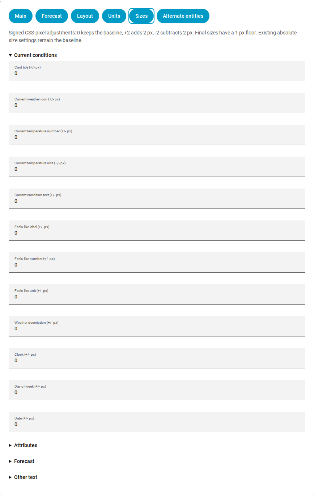
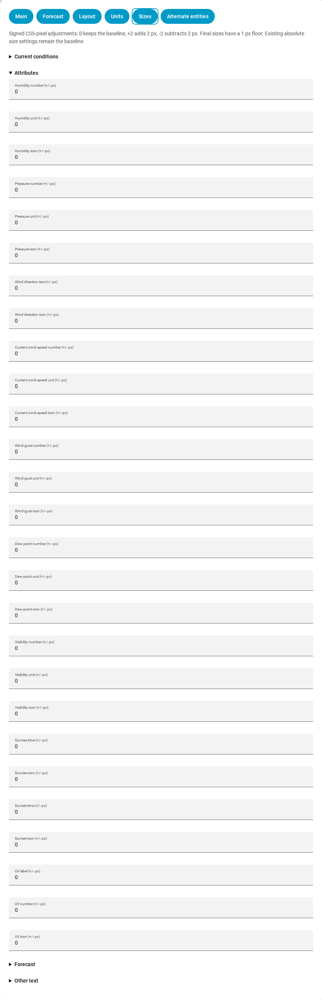
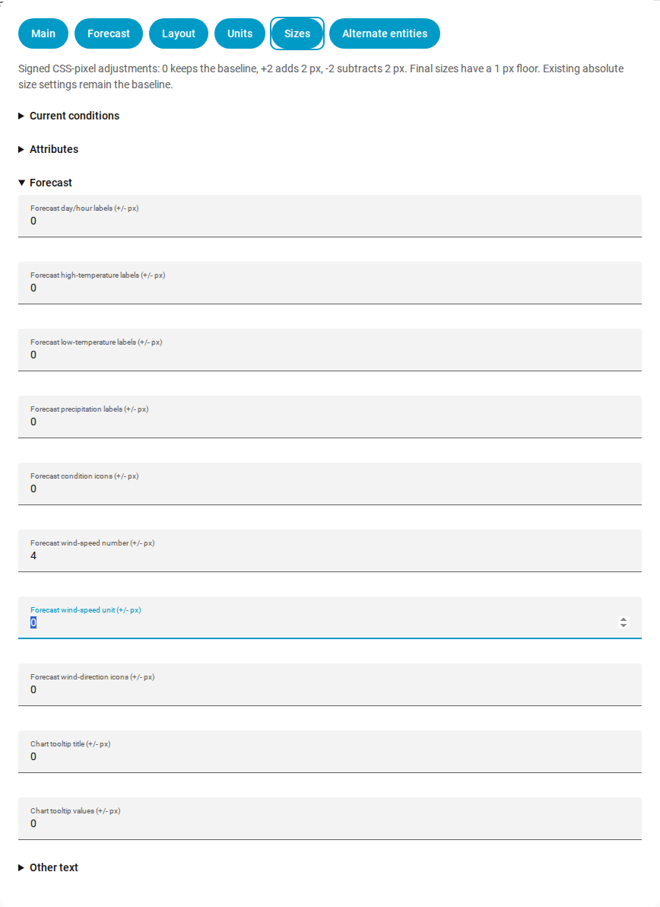
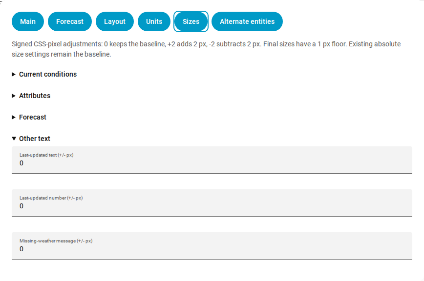
</details>

## Recipes

Replace `weather.home` in these examples with your own weather entity. They are complete **card** configurations; surrounding grid/kiosk configuration belongs to your dashboard, not this card.

### Compact daily card (the daily screenshot)

```yaml
type: custom:weather-chart-card
entity: weather.home
title: Daily forecast
locale: en
attributes_position: center
show_time: true
show_day: true
show_date: true
padding_scale: 0.7
units:
  speed: km/h
size_offsets:
  forecast_wind_speed: +3
forecast:
  type: daily
  number_of_forecasts: 7
  style: style2
  disable_animation: true
  labels_bold: true
  wind_unit_position: hidden
  precipitation_unit_position: hidden
  precipitation_border: false
```

The second attributes row moves into the header, adjustable spacing shrinks by 30%, wind numbers become 14 px, wind/precipitation units disappear, and precipitation labels lose their boxes. The current wind attribute still shows its unit. Header placement may need `left` or `row` on a very narrow card.

### Hourly card (the hourly screenshot)

Use the daily recipe and change these existing fields, rather than adding a second `forecast:` mapping:

```yaml
title: Hourly forecast
forecast:
  type: hourly
  number_of_forecasts: 8
  style: style2
  disable_animation: true
  labels_bold: true
  wind_unit_position: hidden
  precipitation_unit_position: hidden
  precipitation_border: false
```

You get up to eight supplied hourly points. Set `autoscroll: true` at the top level to advance the displayed window each hour. To show wind units below their numbers instead, use `wind_unit_position: below`; set `size_offsets.forecast_wind_unit: +3` to make the unit 12 px too.

### Two cards for an e-paper / monochrome display

Use a normal dashboard **Vertical stack** containing a daily and an hourly Weather Chart Card. Apply the compact recipe to each, then set these forecast colors/animation options independently on both:

```yaml
forecast:
  temperature1_color: '#000000'
  temperature2_color: '#666666'
  precipitation_color: '#999999'
  chart_datetime_color: '#000000'
  chart_text_color: '#000000'
  disable_animation: true
  labels_bold: true
```

This keeps text readable in grayscale. It does not install a screenshot renderer or kiosk add-on, change your theme, or remove outer dashboard gutters. If your existing layout uses layout-card/card-mod, preserve its working grid/margin rules separately. Native icons work without any extra icon download/configuration.

### Chart only

```yaml
type: custom:weather-chart-card
entity: weather.home
show_main: false
show_attributes: false
forecast:
  type: hourly
  condition_icons: false
  show_wind_forecast: false
```

Only the hourly chart remains; no current summary, clock, attributes, condition-icon row or wind row is shown.

### Alternate current sensors

```yaml
type: custom:weather-chart-card
entity: weather.home
temp: sensor.outdoor_temperature
press: sensor.outdoor_pressure
windspeed: sensor.outdoor_wind_speed
wind_gust_speed: sensor.outdoor_gust_speed
show_wind_gust_speed: true
units:
  speed: m/s
  pressure: hPa
```

Only current readings use these sensors. Their unit metadata is respected before converting to the common targets; hourly/daily future values continue to use the weather entity’s forecast data.

## Languages and icons

Card text translations support these shipped locale codes (regional tags fall back to the matching base language, then English):

`bg`, `ca`, `cs`, `da`, `de`, `el`, `en`, `es`, `fi`, `fr`, `hu`, `it`, `ko`, `lt`, `nb`, `nl`, `pl`, `pt`, `ro`, `ru`, `sk`, `sv`, `uk`.

Use `nb` for Norwegian Bokmål. Clock/date formatting is browser-localized. The configurator’s descriptive labels are currently English.

Animated icon sets are included with the HACS download. Custom icons must use SVG filenames from [the day/night icon mappings](src/const.js), such as `clear-day.svg`, `clear-night.svg`, `partly-cloudy-day.svg` and `rain.svg`. Place your own set in a HASS `www/weather-icons/` directory and configure `icons: /local/weather-icons/` with `animated_icons: false`. You are responsible for those custom assets and their licensing. Missing `sun.sun` simply removes solar attributes and uses a safe condition-based icon fallback; it no longer prevents the card rendering.

<details><summary>Bundled animated icon sets</summary>

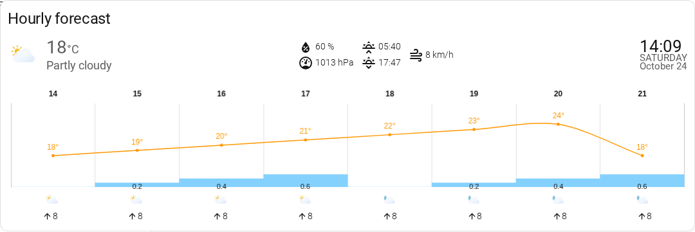
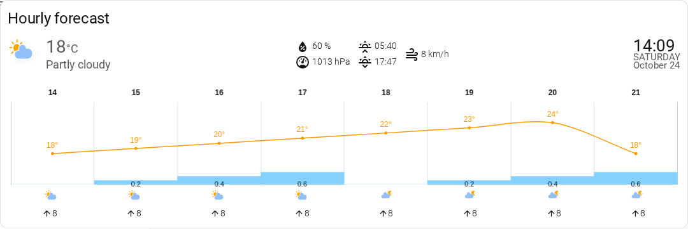
</details>

## Troubleshooting

| Symptom | Check / remedy |
|---|---|
| “Custom element doesn’t exist” | Confirm HACS download, the single JavaScript-module resource, and a full browser reload. |
| “Already registered” / duplicate card element | Remove duplicate resources/other implementations of this same card; reload the browser. |
| Daily works but hourly is empty | Check whether the weather integration actually supports hourly forecasts. The card cannot synthesize an unsupported forecast type. |
| Seven points even when 14 configured | Check the provider’s returned forecast length in Developer tools. The configured count is a cap, not a forecast-generation request. |
| GUI changes do not appear on kiosk | Save the card/dashboard, then reload the kiosk’s browser after HACS updates. Screenshots/caches belong to the renderer too. |
| Current and forecast units differ unexpectedly | Use `units.speed` on each card; remove a conflicting legacy `speed` key. Check alternate sensor `unit_of_measurement`. Temperature follows the weather entity. |
| No feels-like/dew point/description | Enable its visibility flag and confirm the quantity exists or configure an alternate sensor. |
| No solar times | Confirm `sun.sun` exists; solar data is optional. |
| Labels crowded/clipped | Increase chart/card height/width, reduce forecast count or size offsets; use hidden/below units and compact padding as appropriate. |
| Old spacing preferred | Set `padding_scale: 1`. The maintained fork’s default is `0.7`. |
| Custom images missing | Use a trailing slash in `icons`, correct case-sensitive filenames and a URL readable by the kiosk browser. |

## Development and maintenance

See [development and HACS preview workflow](docs/development.md), [layout details](docs/layout.md) and [sizing details](docs/sizing.md). Source changes must be rebuilt into committed `dist/weather-chart-card.js`; HACS downloads the distribution and never compiles source or follows a live checkout.

The validation workflow runs a clean Node 22 install, ESLint/build, a committed-distribution check, a dependency audit and HACS plugin validation. Behavioral acceptance was exercised separately through the real isolated HASS frontend, including clock/subscription cleanup, forecast changes/autoscroll, missing solar data, sensor units and native configuration controls. Screenshots use explicitly synthetic data and contain no production dashboard or credentials.

Default-registry submissions belong in [`hacs/default`’s `plugin` list](https://github.com/hacs/default/blob/master/plugin); inclusion is controlled by HACS maintainers, not this fork. Until inclusion is accepted, the custom-repository installation above is the supported route. This project does not claim to replace or own other maintained forks.

### Credits and license

Original card by [Marc Lamberts](https://github.com/mlamberts78/weather-chart-card); maintained-fork development by [Tomasz Kusmierz](https://github.com/tomtom13). Weather SVG artwork originates from [Bas Milius’ weather icons](https://github.com/basmilius/weather-icons). Chart rendering uses [Chart.js](https://www.chartjs.org/) and chartjs-plugin-datalabels; components use [Lit](https://lit.dev/). See [MIT license](LICENSE.md).
